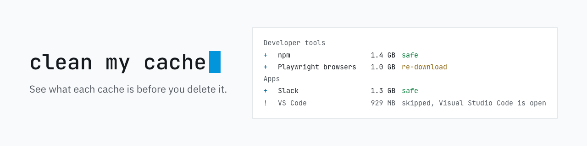

<picture>
  <source media="(prefers-color-scheme: dark)" srcset=".github/assets/banner-dark.png">
  
</picture>

[Read in English](README.md)

# clean my cache

Libere gigabytes no seu Mac limpando o cache que ferramentas de desenvolvimento e apps deixam para trás, e **entenda o que é cada coisa antes de apagar**.

Ele procura os caches, mostra quanto cada um ocupa, você escolhe o que apagar e confirma. Não precisa de Node, Python nem nada: é um binário único e pequeno.

## Instalação

**Homebrew**

```bash
brew install jefferson-calmon/tap/clean-my-cache
```

**Sem Homebrew**

```bash
curl -fsSL https://raw.githubusercontent.com/jefferson-calmon/clean-my-cache/main/install.sh | sh
```

O script baixa o binário certo para o seu Mac (Apple Silicon ou Intel), confere o checksum e instala em `~/.local/bin`.

**Com Go**

```bash
go install github.com/jefferson-calmon/clean-my-cache/cmd/clean-my-cache@latest
```

## Como usar

| O que você quer | Comando |
| --- | --- |
| Escolher o que limpar e confirmar | `clean-my-cache` |
| Só ver quanto espaço dá para liberar | `clean-my-cache scan` |
| Limpar só alguns itens | `clean-my-cache --only npm,slack` |
| Limpar tudo menos alguns itens | `clean-my-cache --exclude 'docker-*'` |
| Mandar para a Lixeira em vez de apagar | `clean-my-cache --trash` |
| Limpar sem perguntas (scripts, cron) | `clean-my-cache --yes` |
| Ver tudo o que ele sabe limpar | `clean-my-cache list` |
| Entender um item | `clean-my-cache explain <id>` |

`--only` e `--exclude` aceitam curinga.

## O que as etiquetas significam

| Etiqueta | Significado | Vem marcado? |
| --- | --- | --- |
| `safe` | Nada se perde. O app recria sozinho. | Sim |
| `re-download` | Nada se perde, mas é baixado ou recompilado na próxima vez, o que pode demorar. | Sim |
| `caution` | Normalmente tranquilo, mas talvez você queira manter (logs, imagens do Docker). | Não, use `--all` ou `--only` |

## Suas próprias receitas

Coloque um arquivo YAML em `~/.config/clean-my-cache/recipes/` e ele aparece junto com os itens que já vêm com a ferramenta:

```yaml
id: minha-ferramenta
name: Minha Ferramenta
category: dev
risk: safe
description: Arquivos que minha ferramenta baixa. Ela baixa de novo quando precisar.
paths:
  - ~/Library/Caches/minha-ferramenta
```

Suas receitas seguem as mesmas regras de segurança. Se for útil para outras pessoas, [abra um pull request](CONTRIBUTING.md).

## O que ele nunca toca

- Nada fora das pastas de cache conhecidas (`~/Library/Caches`, `~/Library/Application Support`, `~/Library/Logs`, `~/.cache`, `~/.npm`, store do pnpm e builds do Xcode)
- Links simbólicos, nem pastas acessadas por um
- Nada que precise de `sudo`
- Mídias do WhatsApp e do Telegram: são suas fotos e vídeos, não cache. Limpe pelo próprio app (Configurações → Armazenamento).

## Licença

MIT
